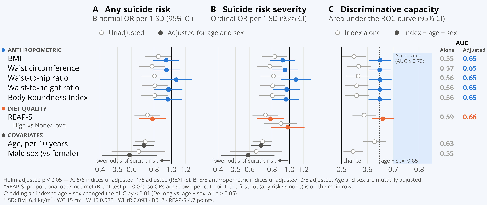
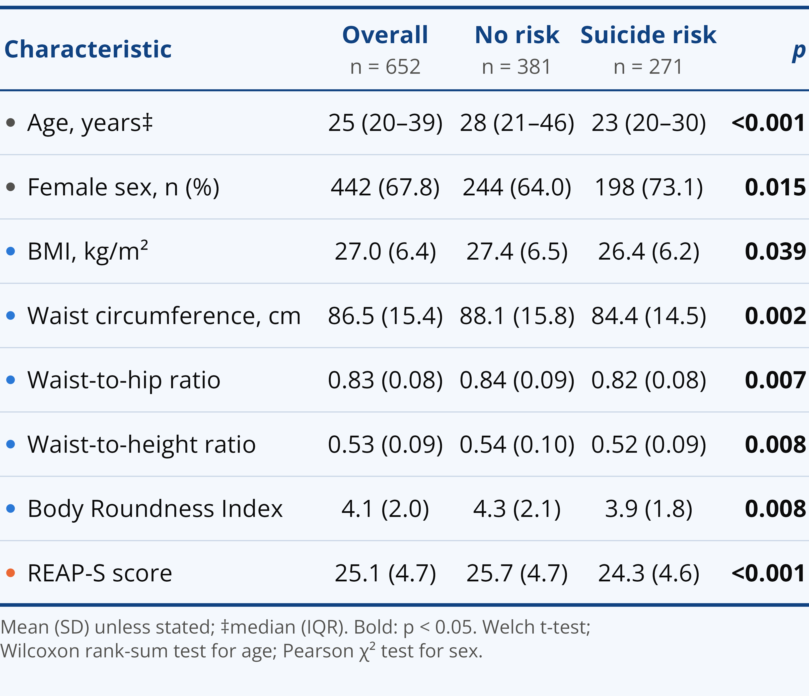
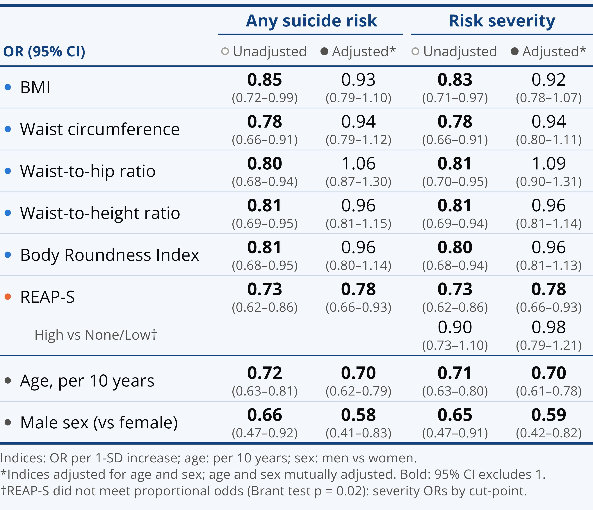

# Body Roundness Index, anthropometrics and diet quality for suicide risk in major depression

**A Preliminary Analysis of the Discriminative Capacity of the Body Roundness Index, Conventional Anthropometrics, and Diet Quality for Identifying Suicide Risk at First Consultation in Major Depression**

José C. González-Cantú<sup>1</sup>, Sofía Jezzini-Martínez<sup>1,2</sup>, Mariah R. Rojas-Newman<sup>1</sup>, Brenda C. Rodríguez-Díaz<sup>1</sup>, Edgar O. Silva-Valdes<sup>1</sup>, Alfredo Cuellar-Barboza<sup>1,3</sup>, Stefan Fernández-Zambrano<sup>1</sup>, Manuel Gardea-Resendez<sup>1,3</sup>

<sup>1</sup> Department of Psychiatry, Universidad Autónoma de Nuevo León, Monterrey, Mexico ·
<sup>2</sup> Institute of Psychiatry, Psychology & Neuroscience, King's College London, London, UK ·
<sup>3</sup> Department of Psychiatry and Psychology, Mayo Clinic, Rochester, Minnesota, USA

Poster presented at the **NNDC 2026 Annual Conference** · Austin, Texas · October 19–20, 2026

> **Preliminary analysis.** Cross-sectional, single-center data presented as a conference poster; not peer reviewed.

**[Poster (PDF)](poster/NNDC2026_poster_Gonzalez-Cantu.pdf)** · **[Supplementary material](SUPPLEMENTARY.md)** · **[Code](code/)** · **[Aggregated results](results/)**

---

## Key findings

- **652** outpatients with major depressive disorder (MDD) at their first psychiatric consultation; **41.6%** had suicide risk.
- Unadjusted, the five anthropometric indices and REAP-S were all associated with lower odds of suicide risk (OR 0.73–0.85 per SD).
- Patients with suicide risk were younger (median age 23 vs 28 years) and more often women (73.1% vs 64.0%). After adjusting for age and sex, no anthropometric index remained associated (adjusted OR 0.93–1.06; all 95% CIs include 1), whereas REAP-S did (adjusted OR 0.78, 95% CI 0.66–0.93).
- REAP-S did not meet the proportional-odds assumption: it was associated with any suicide risk, but not with high vs none/low risk (adjusted OR 0.98, 0.79–1.21).
- No measure discriminated suicide risk (AUC 0.55–0.59). Age and sex alone gave an AUC of 0.65, and adding any index changed it by 0.013 or less (DeLong p ≥ 0.23). No index outperformed BMI.



**Figure 1.** Odds ratios per 1 SD (95% CI), unadjusted (gray) and adjusted for age and sex (color), from binomial (A, any suicide risk) and ordinal (B, risk severity) logistic regression; C, area under the ROC curve of each index alone and with age + sex.

<p>
  
  
</p>

**Table 1** (left). Characteristics by suicide risk. **Table 2** (right). Odds ratios (95% CI), unadjusted and adjusted for age and sex.

## Summary

**Background.** Suicide risk in MDD is complex and still assessed subjectively.<sup>1</sup> Whether a higher body mass index (BMI) is associated with lower suicidal ideation and mortality is debated.<sup>2</sup> The Body Roundness Index (BRI) outperforms BMI for cardiometabolic outcomes;<sup>3</sup> whether anthropometrics or diet quality can identify suicide risk remains unclear.

**Objective.** To evaluate whether BRI, four conventional anthropometric measures and a brief diet-quality screener identify and grade suicide risk at the first psychiatric consultation for MDD.

**Methods.** Cross-sectional analysis of patients with MDD at their first outpatient psychiatric consultation (n = 652). Predictors: BMI, waist circumference (WC), waist-to-hip ratio (WHR), waist-to-height ratio (WHtR), BRI<sup>4</sup> and the Rapid Eating Assessment for Participants–Shortened (REAP-S). Outcome: suicide risk by clinical ascertainment, as presence (yes/no) and severity (none/low/high). For each predictor (per 1 SD): binomial and ordinal logistic regression, unadjusted and adjusted for age and sex, with Holm correction. Assumptions: Box-Tidwell, Cook's distance and Brant tests. Discrimination: AUC (95% CI) alone and with age + sex; DeLong tests.

**Conclusions.** In this preliminary cross-sectional analysis, body size did not signal suicide risk: leaner patients appeared to be at higher risk, but the association disappeared after adjusting for age and sex, and no measure, BRI included, discriminated suicide risk. Higher REAP-S scores were linked to lower odds of any, but not high, suicide risk. Longitudinal studies are needed to confirm these findings.

**Limitations.** Preliminary, cross-sectional, single-center analysis. No adjustment for depressive severity or psychotropic medication, which can affect weight, diet and suicide risk. REAP-S is self-reported and may partly reflect depressive symptoms such as appetite change.

## Repository contents

```
├── README.md
├── SUPPLEMENTARY.md                 Supplementary tables S1–S6 and Figure S1
├── run_all.R                        Runs the whole analysis (requires the private data)
├── code/
│   ├── 01_data_preparation.R        Analytic sample; BMI, WHR, WHtR and BRI
│   ├── 02_table_s1.R                Table S1: characteristics by suicide risk and by sex
│   ├── 03_model_assumptions.R       Brant, Box-Tidwell and Cook's distance
│   ├── 04_models_figures_tables.R   Models, AUC and DeLong tests; Figure 1, Tables 1–2, Figure S1
│   └── 05_supplementary.R           Writes SUPPLEMENTARY.md from results/
├── figures/                         Figures and tables as printed in the poster (PNG, 300 dpi)
├── results/                         Aggregated results (CSV and Markdown); no patient-level data
├── poster/                          Poster (PDF)
├── CITATION.cff
└── LICENSE
```

## Reproducing the analysis

Requirements: R ≥ 4.2 with the packages dplyr, tidyr, gtsummary, MASS, brant, pROC, ggplot2, patchwork, ragg and systemfonts, and the [Open Sans](https://fonts.google.com/specimen/Open+Sans) font for identical figures.

**With the data** (authorized users only). Load the registry export as `base_actualizada`, keep the private exclusion list one level above the repository (`../datos_privados/exclusiones.csv`) and run:

```r
source("run_all.R")
```

This regenerates `figures/`, `results/` and `SUPPLEMENTARY.md`.

**Without the data.** Preview the analysis and figure code on simulated data; outputs go to `demo_output/` and are watermarked "SIMULATED DATA":

```r
DEMO <- TRUE
source("code/04_models_figures_tables.R")
```

## Data availability

The patient-level data come from clinical records and are not publicly available. This repository contains code and aggregated results only. Two records were excluded after manual review (a duplicate visit and inconsistent suicide-risk coding); their record numbers are kept in a private file outside the repository. Requests for data access can be sent to the corresponding author and are subject to institutional approval.

<details>
<summary>Variables used from the registry export</summary>

| Registry column | Variable | Coding / use |
|:---|:---|:---|
| `PESO (kg)` | Weight, kg | |
| `ESTATURA (m)` | Height, m | |
| `CINTURA (cm)` | Waist circumference, cm | |
| `CADERA (cm)` | Hip circumference, cm | |
| `Total...37` | REAP-S total score | |
| `EDAD` | Age, years | |
| `SEXO` | Sex | 1 = female, 2 = male |
| `Riesgo de Suicidio` | Suicide risk | 0 = absent, 1 = present |
| `Categorías de Riesgo Suicida` | Suicide risk category | 0 = none, 1 = low, 2–4 = high (combined) |
| `Discapacidad intelectual (Trastorno del desarrollo intelectual)` | Primary diagnosis | Sample restricted to major depressive disorder |
| `No. REGISTRO` | Record number | Used only to apply the two exclusions; never exported |

Derived indices: BMI = weight / height²; WHR = waist / hip; WHtR = waist / height; BRI = 364.2 − 365.5 × √[1 − (WC / 2π)² / (0.5 × height)²], with WC and height in meters.<sup>4</sup>

</details>

## References

1. Orsolini L, et al. *Psychiatry Investig.* 2020;17(3):207–21. https://doi.org/10.30773/pi.2019.0171
2. Świątecka M, et al. *Qual Sport.* 2026;49:67664. https://doi.org/10.12775/QS.2026.49.67664
3. Eng PC, et al. *Diabetes Obes Metab.* 2025;27(10):5554–65. https://doi.org/10.1111/dom.16601
4. Thomas DM, et al. *Obesity.* 2013;21(11):2264–71. https://doi.org/10.1002/oby.20408

## How to cite

González-Cantú JC, Jezzini-Martínez S, Rojas-Newman MR, Rodríguez-Díaz BC, Silva-Valdes EO, Cuellar-Barboza A, Fernández-Zambrano S, Gardea-Resendez M. A preliminary analysis of the discriminative capacity of the Body Roundness Index, conventional anthropometrics, and diet quality for identifying suicide risk at first consultation in major depression [poster]. NNDC 2026 Annual Conference; 2026 Oct 19–20; Austin, TX. Available from: https://github.com/josegzz1/nndc2026-suicide-risk

## Contact

José C. González-Cantú · jose.gonzalezc@uanl.edu.mx

## License

Code: [MIT License](LICENSE). Poster, figures and text: © 2026 the authors, all rights reserved; please cite when reusing.
