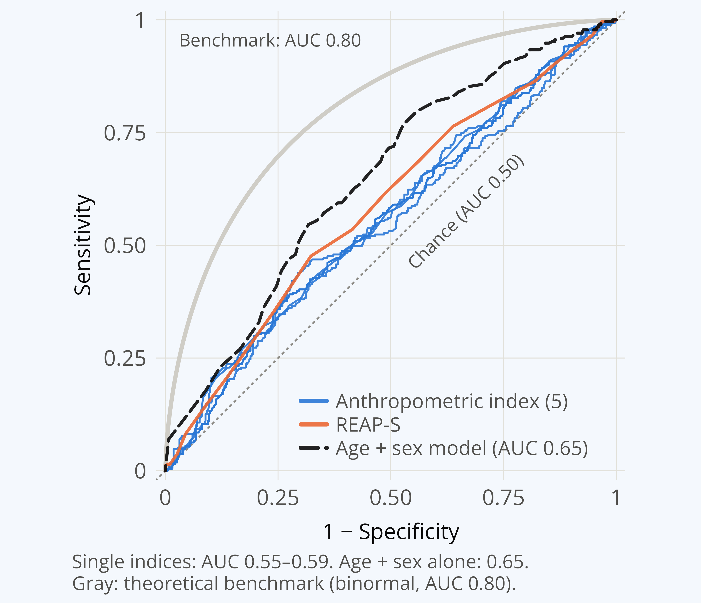

# Supplementary material

*A Preliminary Analysis of the Discriminative Capacity of the Body Roundness Index, Conventional Anthropometrics, and Diet Quality for Identifying Suicide Risk at First Consultation in Major Depression.* NNDC 2026 Annual Conference.

Generated by `code/05_supplementary.R` from the aggregated files in [`results/`](results/). [Back to README](README.md)

S1 Participant flow · S2 Characteristics (Table S1) · S3 Odds ratios · S4 Odds ratios by cut-point · 
S5 Discriminative capacity · S6 Model assumptions

## S1. Participant flow

| Step | n |
|:---|---:|
| Registry records | 1753 |
| Complete data (anthropometrics, REAP-S, diagnosis, suicide risk, sex) | 1652 |
| Major depressive disorder | 654 |
| After exclusions on manual review (duplicate visit; inconsistent risk coding) | 652 |

Two records were excluded after manual review: the second visit of a patient seen twice, and one record 
with inconsistent suicide-risk coding (risk present but risk category none). Their record numbers are kept 
in a private file outside this repository.

## S2. Characteristics of the sample (Table S1)

|**Characteristic**                      | **Overall** (N = 652) | **No suicide risk** (n = 381) | **Suicide risk** (n = 271) | **p (risk)** | **Women** (n = 442) | **Men** (n = 210) | **p (sex)** |
|:---------------------------------------|:---------------------:|:-----------------------------:|:--------------------------:|:------------:|:-------------------:|:-----------------:|:-----------:|
|__Sex, n (%)__                          |                       |                               |                            |  __0.015__   |                     |                   |             |
|Women                                   |      442 (67.8%)      |          244 (64.0%)          |        198 (73.1%)         |              |                     |                   |             |
|Men                                     |      210 (32.2%)      |          137 (36.0%)          |         73 (26.9%)         |              |                     |                   |             |
|__Age (years), Median (Q1, Q3)__        |      25 (20, 39)      |          28 (21, 46)          |        23 (20, 30)         |  __<0.001__  |     26 (21, 41)     |    24 (20, 31)    |    0.11     |
|__Weight (kg), Mean (SD)__              |      72.3 (18.9)      |          73.9 (19.5)          |        70.0 (17.7)         |  __0.009__   |     69.0 (17.4)     |    79.2 (19.9)    | __<0.001__  |
|__Height (m), Mean (SD)__               |      1.63 (0.08)      |          1.64 (0.08)          |        1.63 (0.08)         |     0.11     |     1.60 (0.06)     |    1.71 (0.07)    | __<0.001__  |
|__BMI (kg/m²), Mean (SD)__              |      27.0 (6.4)       |          27.4 (6.5)           |         26.4 (6.2)         |  __0.039__   |     27.0 (6.4)      |    26.9 (6.4)     |     0.9     |
|__Waist circumference (cm), Mean (SD)__ |      86.5 (15.4)      |          88.1 (15.8)          |        84.4 (14.5)         |  __0.002__   |     84.3 (14.8)     |    91.3 (15.6)    | __<0.001__  |
|__Hip circumference (cm), Mean (SD)__   |     103.5 (12.9)      |         104.4 (13.6)          |        102.2 (11.7)        |  __0.025__   |    104.0 (12.8)     |   102.4 (13.0)    |    0.14     |
|__Waist-to-hip ratio, Mean (SD)__       |      0.83 (0.08)      |          0.84 (0.09)          |        0.82 (0.08)         |  __0.007__   |     0.81 (0.08)     |    0.89 (0.07)    | __<0.001__  |
|__Waist-to-height ratio, Mean (SD)__    |      0.53 (0.09)      |          0.54 (0.10)          |        0.52 (0.09)         |  __0.008__   |     0.53 (0.09)     |    0.53 (0.09)    |     0.5     |
|__Body Roundness Index, Mean (SD)__     |       4.1 (2.0)       |           4.3 (2.1)           |         3.9 (1.8)          |  __0.008__   |      4.1 (2.0)      |     4.2 (2.0)     |     0.6     |
|__REAP-S score, Mean (SD)__             |      25.1 (4.7)       |          25.7 (4.7)           |         24.3 (4.6)         |  __<0.001__  |     25.4 (4.7)      |    24.6 (4.8)     |  __0.046__  |
|__Suicide risk category, n (%)__        |                       |                               |                            |              |                     |                   |  __0.041__  |
|None                                    |      381 (58.4%)      |                               |                            |              |     244 (55.2%)     |    137 (65.2%)    |             |
|Low                                     |      157 (24.1%)      |                               |                            |              |     112 (25.3%)     |    45 (21.4%)     |             |
|High                                    |      114 (17.5%)      |                               |                            |              |     86 (19.5%)      |    28 (13.3%)     |             |

Mean (SD) unless stated; age: median (Q1, Q3). p: Welch t-test (means), Wilcoxon rank-sum test (age), Pearson chi-square test without continuity correction (categorical). Suicide risk category: none; low; high (categories 2-4 combined).

## S3. Odds ratios per 1 SD, unadjusted and adjusted for age and sex

Any risk: binomial logistic regression (suicide risk present vs absent). Severity: ordinal (proportional-odds) 
logistic regression (none < low < high). Adjusted models include age and sex. 95% CI by profile likelihood; 
Holm correction across the six indices within each model. Bold: Holm p < 0.05.

| Predictor | Model | Any risk: OR (95% CI) | p | Holm p | Severity: OR (95% CI) | p  | Holm p  |
|:---|:---|---:|---:|---:|---:|---:|---:|
| BMI | Unadjusted | **0.85 (0.72–0.99)** | 0.041 | 0.041 | **0.83 (0.71–0.97)** | 0.018 | 0.027 |
|  | Adjusted | 0.93 (0.79–1.10) | 0.424 | >0.99 | 0.92 (0.78–1.07) | 0.290 | >0.99 |
| Waist circumference | Unadjusted | **0.78 (0.66–0.91)** | 0.003 | 0.013 | **0.78 (0.66–0.91)** | 0.002 | 0.009 |
|  | Adjusted | 0.94 (0.79–1.12) | 0.482 | >0.99 | 0.94 (0.80–1.11) | 0.493 | >0.99 |
| Waist-to-hip ratio | Unadjusted | **0.80 (0.68–0.94)** | 0.007 | 0.029 | **0.81 (0.70–0.95)** | 0.008 | 0.027 |
|  | Adjusted | 1.06 (0.87–1.30) | 0.549 | >0.99 | 1.09 (0.90–1.31) | 0.382 | >0.99 |
| Waist-to-height ratio | Unadjusted | **0.81 (0.69–0.95)** | 0.009 | 0.029 | **0.81 (0.69–0.94)** | 0.007 | 0.027 |
|  | Adjusted | 0.96 (0.81–1.15) | 0.674 | >0.99 | 0.96 (0.81–1.14) | 0.668 | >0.99 |
| Body Roundness Index | Unadjusted | **0.81 (0.68–0.95)** | 0.010 | 0.029 | **0.80 (0.68–0.94)** | 0.007 | 0.027 |
|  | Adjusted | 0.96 (0.80–1.14) | 0.612 | >0.99 | 0.96 (0.81–1.13) | 0.608 | >0.99 |
| REAP-S | Unadjusted | **0.73 (0.62–0.86)** | <0.001 | 0.001 | **0.77 (0.66–0.90)** | <0.001 | 0.005 |
|  | Adjusted | **0.78 (0.66–0.93)** | 0.005 | 0.027 | 0.83 (0.71–0.98) | 0.024 | 0.143 |

1 SD: BMI 6.4 kg/m²; Waist circumference 15 cm; Waist-to-hip ratio 0.085; Waist-to-height ratio 0.093; Body Roundness Index 2; REAP-S 4.7 points.
REAP-S did not meet the proportional-odds assumption (S6); see S4 for its severity odds ratios by cut-point.

Age and sex, alone and mutually adjusted:

| Covariate | Model | Any risk: OR (95% CI) | p | Severity: OR (95% CI) | p  |
|:---|:---|---:|---:|---:|---:|
| Age, per 10 years | Unadjusted | 0.72 (0.63–0.81) | <0.001 | 0.71 (0.63–0.80) | <0.001 |
|  | Mutually adjusted | 0.70 (0.62–0.79) | <0.001 | 0.70 (0.61–0.78) | <0.001 |
| Male sex (vs female) | Unadjusted | 0.66 (0.47–0.92) | 0.015 | 0.65 (0.47–0.91) | 0.012 |
|  | Mutually adjusted | 0.58 (0.41–0.83) | 0.003 | 0.59 (0.42–0.82) | 0.002 |

## S4. Odds ratios by cut-point of suicide-risk severity

Separate binomial logistic regressions for each cut-point of the ordinal outcome; OR per 1 SD; adjusted 
models include age and sex. The first cut-point is the binomial model of S3. Bold: 95% CI excludes 1.

| Predictor | Cut-point | Unadjusted OR (95% CI) | p | Adjusted OR (95% CI) | p  |
|:---|:---|---:|---:|---:|---:|
| BMI | Any risk vs none | **0.85 (0.72–0.99)** | 0.041 | 0.93 (0.79–1.10) | 0.424 |
|  | High vs none/low | **0.77 (0.61–0.95)** | 0.019 | 0.88 (0.70–1.09) | 0.244 |
| Waist circumference | Any risk vs none | **0.78 (0.66–0.91)** | 0.003 | 0.94 (0.79–1.12) | 0.482 |
|  | High vs none/low | **0.77 (0.62–0.96)** | 0.020 | 0.97 (0.77–1.22) | 0.815 |
| Waist-to-hip ratio | Any risk vs none | **0.80 (0.68–0.94)** | 0.007 | 1.06 (0.87–1.30) | 0.549 |
|  | High vs none/low | 0.84 (0.68–1.03) | 0.097 | 1.18 (0.91–1.52) | 0.212 |
| Waist-to-height ratio | Any risk vs none | **0.81 (0.69–0.95)** | 0.009 | 0.96 (0.81–1.15) | 0.674 |
|  | High vs none/low | **0.80 (0.64–0.98)** | 0.039 | 0.99 (0.78–1.24) | 0.917 |
| Body Roundness Index | Any risk vs none | **0.81 (0.68–0.95)** | 0.010 | 0.96 (0.80–1.14) | 0.612 |
|  | High vs none/low | **0.79 (0.63–0.99)** | 0.044 | 0.98 (0.77–1.23) | 0.885 |
| REAP-S | Any risk vs none | **0.73 (0.62–0.86)** | <0.001 | **0.78 (0.66–0.93)** | 0.005 |
|  | High vs none/low | 0.90 (0.73–1.10) | 0.288 | 0.98 (0.79–1.21) | 0.841 |

## S5. Discriminative capacity

AUC of the fitted probabilities with DeLong 95% CI. ΔAUC: change when the index is added to the age + sex 
model, tested with paired DeLong tests.

| Predictor | AUC alone (95% CI) | AUC with age + sex (95% CI) | ΔAUC vs age + sex | DeLong p |
|:---|---:|---:|---:|---:|
| BMI | 0.55 (0.50–0.59) | 0.65 (0.61–0.69) | +0.003 | 0.479 |
| Waist circumference | 0.57 (0.52–0.61) | 0.65 (0.61–0.69) | +0.001 | 0.789 |
| Waist-to-hip ratio | 0.56 (0.52–0.61) | 0.65 (0.61–0.69) | +0.003 | 0.335 |
| Waist-to-height ratio | 0.56 (0.51–0.60) | 0.65 (0.61–0.69) | +0.001 | 0.611 |
| Body Roundness Index | 0.56 (0.51–0.60) | 0.65 (0.61–0.69) | +0.001 | 0.687 |
| REAP-S | 0.59 (0.54–0.63) | 0.66 (0.62–0.70) | +0.013 | 0.231 |

Reference models: age + sex 0.65 (0.60–0.69); age alone 0.63; sex alone 0.55.
Pairwise DeLong tests between the six indices alone (15 pairs): smallest p = 0.148; all Holm-adjusted p ≥ 1.00.

**Figure S1.** ROC curves of the six indices alone and of the age + sex model; gray curve: theoretical 
benchmark (binormal, AUC 0.80).

## S6. Model assumptions

**Proportional odds (Brant test)** in the ordinal models; p < 0.05 indicates that the assumption is not met.

| Predictor | Unadjusted: χ² (df), p | Adjusted, omnibus: χ² (df), p | Adjusted, index: χ² (df), p |
|:---|---:|---:|---:|
| BMI | 1.00 (1), 0.318 | 1.83 (3), 0.608 | 0.40 (1), 0.528 |
| Waist circumference | 0.01 (1), 0.938 | 1.53 (3), 0.675 | 0.12 (1), 0.733 |
| Waist-to-hip ratio | 0.22 (1), 0.643 | 2.25 (3), 0.523 | 0.79 (1), 0.374 |
| Waist-to-height ratio | 0.02 (1), 0.890 | 1.51 (3), 0.680 | 0.06 (1), 0.806 |
| Body Roundness Index | 0.02 (1), 0.878 | 1.52 (3), 0.678 | 0.07 (1), 0.788 |
| REAP-S | 4.90 (1), 0.027 | 7.12 (3), 0.068 | 5.50 (1), 0.019 |

**Linearity of the logit (Box-Tidwell test).** Likelihood-ratio p for the x·log(x) term of each index (and of 
age in the adjusted models); p < 0.05 suggests non-linearity.

| Predictor | Any risk, unadjusted | Any risk, adjusted: index | Any risk, adjusted: age | Severity, unadjusted | Severity, adjusted: index | Severity, adjusted: age |
|:---|---:|---:|---:|---:|---:|---:|
| BMI | 0.521 | 0.644 | 0.242 | 0.385 | 0.789 | 0.312 |
| Waist circumference | 0.950 | 0.430 | 0.228 | >0.99 | 0.404 | 0.263 |
| Waist-to-hip ratio | 0.657 | 0.539 | 0.185 | 0.732 | 0.698 | 0.211 |
| Waist-to-height ratio | 0.861 | 0.434 | 0.199 | 0.941 | 0.466 | 0.236 |
| Body Roundness Index | 0.914 | 0.446 | 0.200 | 0.837 | 0.464 | 0.236 |
| REAP-S | 0.877 | 0.741 | 0.120 | 0.808 | 0.984 | 0.175 |

**Influential observations (Cook's distance > 4/n)** in the binomial models; OR per 1 SD with all patients and after excluding influential observations (sensitivity analysis).

| Predictor | Model | Influential (n) | OR, all (p) | OR, without influential (p) | Change in OR |
|:---|:---|---:|---:|---:|---:|
| BMI | Unadjusted | 12 | 0.85 (0.041) | 0.72 (<0.001) | -15.0% |
|  | Adjusted | 15 | 0.93 (0.424) | 0.92 (0.382) | -1.2% |
| Waist circumference | Unadjusted | 10 | 0.78 (0.003) | 0.69 (<0.001) | -11.9% |
|  | Adjusted | 15 | 0.94 (0.482) | 0.94 (0.546) | +0.5% |
| Waist-to-hip ratio | Unadjusted | 11 | 0.80 (0.007) | 0.70 (<0.001) | -12.6% |
|  | Adjusted | 16 | 1.06 (0.549) | 1.06 (0.589) | -0.1% |
| Waist-to-height ratio | Unadjusted | 11 | 0.81 (0.009) | 0.71 (<0.001) | -12.4% |
|  | Adjusted | 13 | 0.96 (0.674) | 0.99 (0.900) | +2.6% |
| Body Roundness Index | Unadjusted | 13 | 0.81 (0.010) | 0.67 (<0.001) | -17.0% |
|  | Adjusted | 14 | 0.96 (0.612) | 0.96 (0.645) | +0.0% |
| REAP-S | Unadjusted | 15 | 0.73 (<0.001) | 0.62 (<0.001) | -15.4% |
|  | Adjusted | 19 | 0.78 (0.005) | 0.73 (<0.001) | -6.3% |

